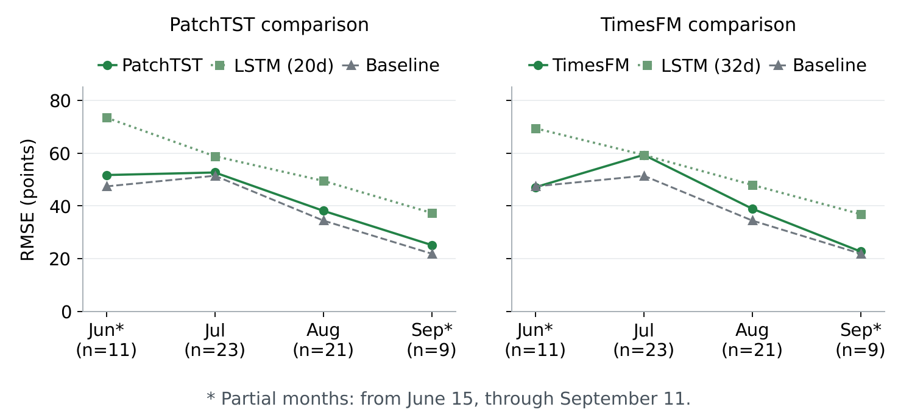

# SSE Composite Index Forecasting: Methodology and Findings

[简体中文](README.md) | **English**

ARIMA · LSTM · PatchTST · TimesFM 2.5

This study evaluates how well ARIMA, LSTM, PatchTST, and TimesFM 2.5 forecast the next-trading-day closing level of the SSE Composite Index (Shanghai Composite). The central question is whether, with the information available at forecast time strictly limited, a model can deliver a reproducible improvement over the previous-close baseline. The repository publishes the research methodology, implementation code, day-by-day forecast records, and evaluation results to support independent verification. PatchTST uses the original authors' implementation, and TimesFM uses Google Research's official pretrained model; see the [third-party notices](THIRD_PARTY_NOTICES.md) for model sources and licenses.

[Read the original PDF (Chinese)](reports/experiment-report.pdf) · [Figure source code](scripts/render_report_figures.py) · [How to run](#7-running-and-reproduction) · [Verify the original results](results/reference/)

> This is an English translation of the Chinese [README.md](README.md); if the two differ, the Chinese version prevails. Figure labels are in Chinese; figures with English labels can be generated locally (see [Redraw the report figures](#redraw-the-report-figures-and-the-original-pdf-figures)).

Report date: September 20, 2026. Market data through September 11, 2026. The subject is the daily SSE Composite Index, and the forecast target is the next trading day's closing level. Statistical forecast accuracy and investment-strategy returns are evaluated separately; this report has not yet validated strategy returns with trade execution and after costs.

**Main finding: over the fixed configurations and historical review periods of this study, no model in the main comparisons achieved an overall level RMSE below the previous-close baseline.** The improved ARIMA lowered RMSE relative to the original version; the improvements for PatchTST and TimesFM 2.5 appear as lower errors relative to the corresponding LSTM configurations. These results do not yet support the claim that any model has stable incremental predictive ability or a tradable return advantage, nor can they be extrapolated to an assessment of all model configurations.


Figure 1  RMSE shown separately for each experimental condition. Comparisons are valid within each panel; the ARIMA test period differs from the other two groups, and those two also differ in input length and training approach, so this is not a unified architecture ranking.

| Method | Learning approach | Focus of this round |
| --- | --- | --- |
| ARIMA | Classical statistical time-series model | Check differencing, order, and training window |
| LSTM | Recurrent neural network with gated memory | Two-year rolling training; daily-retrained comparison of 20- vs 32-day inputs |
| PatchTST | Transformer applied to patches of the series | Small model trained from scratch on local history |
| TimesFM 2.5 | Pretrained time-series Transformer | Direct forecasts with frozen official weights |

### How to read this report

Start with the data split and forecasting task, then each model's method, actual curves, and errors, and finally the limits of the conclusions. RMSE and MAE in the tables are in index points; lower is better. Directional accuracy and investment returns are separate evaluation targets.

## 1. Data and Experimental Design

*One market-data snapshot; historical information used in strict time order*

The data come from a saved Yahoo Finance snapshot of daily SSE Composite Index data, ticker 000001.SS. This document consolidates the original experiments; it does not update the market data or re-select test days. The later paired experiments all use Close; the earlier LSTM work also explored inputs such as open, high, and volume.

| Experiment | Review period and sample | Information known at forecast time |
| --- | --- | --- |
| ARIMA improvement | 2026-03-16 to 09-11 / 125 trading days | Historical daily log returns within the window / 126, 252, or expanding window |
| PatchTST vs LSTM | 2026-06-15 to 09-11 / 64 trading days | Prior two years for training / latest 20 consecutive trading days as input |
| TimesFM vs LSTM | 2026-06-15 to 09-11 / 64 trading days | Latest 32 days as input; LSTM trained on two years / TimesFM uses frozen pretrained weights |

### What the training history and the input window each determine

The "two-year training history" is used to build a large number of training examples; the "20-day or 32-day input" is the recent span each example observes. For example, to forecast June 15, the LSTM uses only data up to and including June 12, and a 32-day input covers April 27 to June 12. For the next target day, the window moves forward by one date.

### Order of rolling one-step forecasting

Step 1: take the actual history before the target day. Step 2: fit or load the model and output a forecast for the next trading day. Step 3: align the forecast with the actual close on that date and score it. Only after moving on to the next target day may the just-realized market data be added to the history. The three-month forecast lines in the figures connect 64 separate one-step forecasts; they are not a single forecast of the next three months.

### How the validation stage is kept separate from scoring

ARIMA's 18 candidates were selected only on an earlier validation period, 2025-03-14 to 2026-03-13. In the later LSTM and PatchTST experiments, each day the last 40 target days of the history window serve as internal validation for choosing the number of epochs (up to 40); the model is then re-initialized and retrained on the full known two-year history. Normalization during validation does not use data from the validation target days. TimesFM is not fine-tuned in this round, and no parameters are chosen based on test error.

### Evaluation metrics and baseline

- **Previous-close baseline:** forecast close = actual close of the previous trading day.
- **MAE:** the mean of daily absolute errors, i.e., how many points a forecast typically misses by.
- **RMSE:** the square root of the mean squared error; more sensitive to large forecast errors.

These dates had already been examined in earlier research, so this document refers to the exercise as a historical review. The time split prevents a day's actual value from entering that day's forecast, but repeatedly studying the same period can still introduce selection bias.

## 2. ARIMA Experiment

*Check differencing first, then compare a small set of orders and training windows*

**Principle and goal:** ARIMA builds a linear model from past values and past forecast errors; d denotes the number of differences. This project first computes the daily log return log(close / previous close), forecasts the return, and then recovers the index level as "previous close × exp(forecast return)". The original ARIMA(5,1,0) expanded its history each day, refit, and forecast the next day.

**Improved method:** setting d = 1 again on returns may cause over-differencing. After checking with ADF, KPSS, and autocorrelation diagnostics, 6 fixed structures × 3 windows were evaluated, 18 candidates in total; the windows were 126 returns, 252 returns, or an expanding window. Selection was based only on level RMSE over the earlier validation period. The result was ARIMA(0,0,0) with a constant and a 252-return window — in effect, the historical mean return.


Figure 2  The left side of the upper panel shows the 253 actual closes needed for the first forecast, corresponding to 252 historical returns; the right side shows the 125-day forecasts against the actual path. The lower panel zooms into the test period. When forecast returns are close to zero, the recovered levels still track the previous close, so a closely matching level curve does not mean the model captured next-day moves. See also the [daily log-return diagnostic chart](reports/figures/arima_returns.png).

| Method | RMSE | MAE |
| --- | --- | --- |
| Original ARIMA(5,1,0) | 45.20 | 35.34 |
| Selected 252-return mean | 41.68 | 31.48 |
| Previous-close baseline | 41.42 | 31.46 |

**Conclusion:** RMSE fell 7.79% relative to the original version but was 0.63% higher than the baseline. The block-bootstrap results of the original experiment also did not confirm a stable advantage over the baseline. The mean-return model predicted a rise on all 125 days; its 54.4% directional accuracy equals the share of up days in the period and cannot be interpreted as having learned effective market timing.

## 3. LSTM Experiment

*Daily retraining and one-step forecasting over a rolling history window*

**Principle:** LSTM is a recurrent neural network with gated memory; input, forget, and output gates control how historical information is updated and retained. This study uses its ability to model nonlinear sequential relationships to test whether recent closing sequences contain next-day predictive information beyond the previous-close baseline.

**Experimental design:** for each target day, the model is retrained on actual closes from the preceding two years and takes the most recent 20- or 32-day close sequence as input to forecast the next trading day's close. The 20-day version is paired with PatchTST and the 32-day version with TimesFM; each pair shares forecast dates, actual values, and the previous-close baseline. Both sets of LSTM results reported here are rolling one-step forecasts; the earlier multivariate and multi-step explorations are excluded from this round's performance comparison.

**Model architecture:** LSTM 32 units → LSTM 16 units (ReLU) → Dense 1. Each day uses only past data; after internal validation selects the number of training epochs, the model, optimizer, and full-history normalization are re-initialized, and the model is refit on all known training samples.


Figure 3  The left side of the upper panel shows the two years of actual history used for the first training; the right side shows the 64 next-day forecasts of the 32-day-input version. The lower panel zooms into the test period. Green is the LSTM, red the actual close, and gray the previous-close baseline. The training implementation lives separately in `experiments/lstm/`; the 20-day and 32-day versions are the same implementation with different input parameters.

| Same 64 dates | RMSE | MAE |
| --- | --- | --- |
| Two-year training + 20-day input | 56.28 | 46.51 |
| Two-year training + 32-day input | 55.08 | 43.43 |
| Previous-close baseline | 42.31 | 32.26 |

**Conclusion:** in this run, the 32-day version was slightly better than the 20-day version, but neither beat the previous-close baseline. The 32-day version hit the 40-epoch cap on 19 of 64 target days, which indicates the result is constrained by the current training budget; it cannot be inferred that every LSTM configuration is ineffective.

## 4. PatchTST Experiment

*A small Transformer trained on local history*

**Principle:** PatchTST first splits a time series into patches and then uses attention to learn relationships between them. This project uses the authors' official supervised-learning implementation without loading pretrained weights. The latest 20 days are split into 6 overlapping patches of length 5 with stride 3.

**Setup:** 2 Transformer layers, 4 attention heads, d_model = 32, 17,667 parameters in total, with the official RevIN and LayerNorm. Each day, the model is trained on the previous two years of Close and compared with the LSTM using the same 20-day input. Both use the same validation-based epoch-selection rule, though details such as normalization and framework still differ.


Figure 4  The left side of the upper panel is the two-year training history for the first forecast; the right side is the 64-day test period. The lower panel zooms into the test period. The solid green line is PatchTST, the light-green dotted line is the LSTM with the same 20-day input, the red line is the actual close, and the gray line is the baseline.

| Both with 20-day input | RMSE | MAE |
| --- | --- | --- |
| PatchTST | 44.94 | 32.93 |
| LSTM | 56.28 | 46.51 |
| Previous-close baseline | 42.31 | 32.26 |

**Conclusion:** PatchTST's RMSE was 20.15% lower than the corresponding LSTM but 6.20% higher than the baseline. It beat the LSTM in all four monthly intervals, yet beat the baseline in none. The evidence currently supports "a small PatchTST outperforms this version of the LSTM", not "the attention mechanism delivers a tradable forecasting advantage".

## 5. TimesFM 2.5 Experiment

*Frozen pretrained weights used directly for next-day forecasts*

**Principle:** TimesFM 2.5 is Google's general-purpose pretrained time-series model. Unlike PatchTST, which is trained from scratch locally, it has already learned sequence patterns from external data; in this round its weights are frozen and it forecasts directly from new inputs, i.e., zero-shot inference. It was not trained specifically for the SSE Composite Index.

**Setup:** the official PyTorch version is used, pinned to the weights publicly released in 2025; each call takes 32 actual closes as input and forecasts the next trading day. The official point forecast is taken from the median channel. The LSTM is also retrained with a 32-day input; dates, actual values, and baseline are exactly the same as in the 20-day group. TimesFM was not trained or fine-tuned on the two-year history shown on the left.


Figure 5  The blue line on the left represents only the LSTM's first training history. The green TimesFM line connects 64 one-step forecasts, each of which reads only the 32 actual closes before its target day. The lower panel compares it with the 32-day LSTM and the baseline.

| Both with 32-day input | RMSE | MAE |
| --- | --- | --- |
| TimesFM 2.5 | 47.04 | 34.65 |
| LSTM | 55.08 | 43.43 |
| Previous-close baseline | 42.31 | 32.26 |

**Conclusion:** TimesFM's RMSE was 14.60% lower than this round's LSTM but 11.18% higher than the baseline. Its directional accuracy of 57.81% ties the "always predict up" directional baseline (37/64), so this figure alone cannot demonstrate any timing value. The two models are trained on different information, so the difference in results cannot be attributed to architecture alone.

## 6. Overall Conclusions and Next Validation Steps

*First confirm whether there is any predictive gain, then decide whether to add complexity*

**What can be confirmed:** over the historical periods examined and with the fixed configurations used, the corrected ARIMA specification, the small PatchTST, and TimesFM pretrained inference each reduced some of the errors of their corresponding comparison model; yet in each main comparison the overall RMSE remained above the previous-close baseline.



Figure 6  Monthly RMSE for the two 64-day experiments. June and September are partial months. PatchTST did not beat the baseline in any of the four intervals; TimesFM was slightly below the baseline only in June and above it in the other intervals.

### A close-looking curve is not an effective forecast

Index levels are strongly anchored to the previous day's close, so a model that simply follows the most recent level can draw a curve that looks close to the actuals. What actually needs to be tested is new predictive information relative to the baseline. Curve shape, error reduction, directional hits, and profit after costs are evidence at different levels. The current experiments have not validated a profitable trading strategy.

From an investment-decision perspective, the economic value of a level forecast can only be tested once it is mapped to explicit position rules and combined with a tradable instrument, signal timing, execution price, transaction costs, slippage, and risk constraints. A forecast of the next trading day's close is not an executable fill price; this study has not built that full trading chain, so the forecast curves and directional accuracy should not be interpreted directly as buy or sell instructions.

### Limits of the conclusions

- The sample period is short and has been examined repeatedly; there is no fresh, completely untouched final test period.

- The 20-day and 32-day inputs differ, and pretrained and locally trained models have access to different information; a fair architecture ranking across all models is not possible.

- Monthly wins in individual intervals and directional accuracy cannot demonstrate a stable long-term advantage; the current training budget and number of random seeds are also limited.

### Suggested next steps

Freeze the current configurations and evaluation rules, and continue rolling tests on new dates not used for tuning, reporting level errors, return errors, and the directional baseline together. If a trading strategy is built later, validate turnover, costs, slippage, and maximum drawdown separately. At this stage the priority is testing the information set and validation design, not scaling up the models.

### Result sources and reproduction records

- ARIMA: [original and improved results](results/reference/arima/).
- LSTM and PatchTST: [20-day-input paired results](results/reference/patchtst/).
- TimesFM and LSTM: [32-day-input paired results](results/reference/timesfm/).
- Standalone LSTM: the [20-day archive](results/reference/lstm/history_20/) and the [32-day archive](results/reference/lstm/history_32/), extracted column by column from the corresponding paired results with identical values.
- [Release archive manifest and checksums](results/reference/manifest.json).

The figures and tables above come from the actual forecast records of completed experiments. All current forecast figures share one layout: "actual history on the left, test comparison on the right" in the upper panel and a test-period close-up in the lower panel. The PDF preserves the original report, and its six original-layout figures can also be rebuilt with the code in this repository; `sse-*-20260914` in the PDF is the original experiment directory name. Errors can be recomputed offline from the archived data; retraining writes to `runs/`.

## 7. Running and Reproduction

### Verify the reported results first

After downloading or cloning the repository, run from the repository root:

```bash
python scripts/verify_results.py
```

This step uses only the Python standard library and neither downloads market data nor trains networks: it recomputes the 18 MAE/RMSE metrics in the report, checks the standalone LSTM records row by row against the paired experiments, and verifies chronological order, the shared baseline, and the hashes of the archived files, figures, and PDF.

### Set up the environment and prepare market data

This release was verified on Windows with Python 3.12 on CPU. Dependencies are pinned to the locally verified versions, and the scripts use repository-relative paths and the current Python interpreter. Other operating systems and fresh-environment installs have not each been tested; differences in framework versions or hardware may change the numerical results of the neural networks.

```bash
python -m venv .venv
```

Activate on Windows PowerShell with `.\.venv\Scripts\Activate.ps1`, or on macOS/Linux with `source .venv/bin/activate`. All following commands are run in the activated environment from the repository root.

```bash
python -m pip install -r requirements/base.txt
python scripts/fetch_data.py
```

This downloads daily `000001.SS` data for the fixed range `2023-03-01` to `2026-09-11` and saves it locally to `data/yahoo_sse.json`. An existing cache is kept; pass `--force` explicitly to replace it. You can also import an existing snapshot:

```bash
python scripts/fetch_data.py --from-file /path/to/yahoo_raw.json
```

Yahoo may rate-limit requests or revise historical data. The program validates the market data and records a fingerprint of the normalized dates/closes; newly downloaded data are not guaranteed to match the original experiment's snapshot exactly. Reference fingerprints are in [manifest.json](results/reference/manifest.json). These entry points reproduce the fixed historical experiments; changing the ticker or dates also requires adjusting the protocol and sample counts accordingly.

### Redraw the report figures and the original PDF figures

Once the base dependencies are installed and historical market data matching the archived fingerprint are in place, the figures can be redrawn directly, without TensorFlow, PyTorch, TimesFM weights, or retraining:

```bash
python scripts/render_report_figures.py
python scripts/render_report_figures.py --layout original --output runs/pdf-original-figures
```

The first command generates the six main figures in the README plus the ARIMA return diagnostic chart, written to `reports/figures/` by default. The second rebuilds the six figures of the original PDF in their original layout. Each run checks 34 RMSE values and that the actual history matches the archived closes, and saves a manifest of figure sources and date ranges.

Different fonts may change the image bytes. Chinese figures need a font such as Microsoft YaHei or Noto Sans CJK SC; without a Chinese font, add `--language en`. To keep the published Chinese figures in `reports/figures/` (whose hashes `verify_results.py` checks), write English figures to a separate directory:

```bash
python scripts/render_report_figures.py --language en --output runs/figures-en
```

Figure layout is handled by the [shared plotting module](forecast_plotting.py), which the actual run outputs of all four methods also use. The left side of the TimesFM figure is explicitly a historical reference and does not represent its pretraining data.

### ARIMA

```bash
python experiments/arima/run_all.py --smoke
python experiments/arima/run_all.py --workers 3
```

The first command only checks the original model on two days and one fit of each of the 18 candidates; the second runs, in order, the original ARIMA, validation-period selection, the six-month historical review, and plotting. See the [ARIMA experiment entry point](experiments/arima/README.md) (Chinese) for details.

### Standalone LSTM: 20-day or 32-day input

```bash
python -m pip install -r requirements/lstm.txt
python experiments/lstm/run_all.py --history 20 --limit 1
python experiments/lstm/run_all.py --history 32 --limit 1
```

Remove `--limit 1` to run the full 64 days for each. There is a single training core, [experiments/lstm/train.py](experiments/lstm/train.py), with caches stored separately in `runs/lstm/history_20/` and `runs/lstm/history_32/`. The PatchTST/TimesFM comparisons call the same entry point and reuse the corresponding results, checking configuration, dates, data fingerprint, and input window so that the two caches cannot be mixed up.

To plot only the existing standalone LSTM archived results:

```bash
python experiments/lstm/render_comparison.py --history 20 --reference
python experiments/lstm/render_comparison.py --history 32 --reference
```

Output goes to `runs/lstm_reference/history_20/` and `history_32/`, using the same history/test plus test close-up layout.

### PatchTST and LSTM: 20-day input

```bash
python -m pip install -r requirements/patchtst.txt
python experiments/patchtst/run_all.py --limit 1
python experiments/patchtst/run_all.py
```

`--limit 1` checks only the first target day but keeps the full 40-epoch validation-based epoch selection and retraining. Remove the flag to run all 64 days; runs can resume from completed dates. The upstream source is kept in `third_party/PatchTST/`, and each run verifies the pinned version hash. See [PatchTST / LSTM20](experiments/patchtst/README.md) for details.

### TimesFM 2.5 and LSTM: 32-day input

```bash
python -m pip install -r requirements/timesfm.txt
python experiments/timesfm/run_all.py --limit 1
python experiments/timesfm/run_all.py
```

The first run downloads about 925 MB of weights from Google's official Hugging Face repository, pins the revision, verifies the SHA-256, and caches them in `.cache/timesfm/`. An existing complete copy of the weights can be reused by pointing `SSE_TIMESFM_CHECKPOINT` to its directory. TimesFM's weights stay frozen; the LSTM is retrained daily. See [TimesFM / LSTM32](experiments/timesfm/README.md) for details.

### Outputs, verification scope, and layout

After a full run, each experiment saves daily forecasts, metrics, models, and figures under `runs/`. Running with `--limit 1` alone does not produce full 64-day metrics. All LSTM training is invoked from `experiments/lstm/`; the old `run_lstm.py` in the paired directories is kept only as a compatibility entry point.

Verification completed for this repository release:

- Offline verification of the archived results, data-integrity and plot time-boundary tests, and Python compilation checks.
- Limited-fit checks of the original ARIMA model on two days and of the 18 candidates.
- Full first-day training for PatchTST, LSTM20, and LSTM32, plus actual first-day TimesFM inference and a model-reload check; the first-day forecasts of all four branches match the original experiment records.
- The full 64-day network training was not re-run for this release; the full-period metrics in this document come from the archived original experiments.

```bash
python -m unittest discover -s tests -v
python -m unittest experiments.lstm.test_protocol -v
```

```text
sse-forecast-benchmark/
├── README.md                  # Illustrated experiment report and run guide (Chinese)
├── README.en.md               # English translation of README.md
├── benchmark_support.py       # Market-data validation and data fingerprints
├── forecast_plotting.py       # History/test layout shared by all four methods
├── experiments/
│   ├── arima/                 # Original model, order/window comparison, plotting
│   ├── patchtst/              # PatchTST, calls the shared LSTM20 comparison
│   ├── timesfm/               # TimesFM 2.5, calls the shared LSTM32 comparison
│   └── lstm/                  # Standalone LSTM; one training implementation for 20/32 days
├── requirements/              # Pinned dependencies, split by experiment
├── scripts/                   # Data download, result verification, PDF/report figure rebuilds
├── tests/                     # Data-integrity and plot time-boundary tests
├── results/reference/         # Published experiment records and checksum manifest
├── reports/                   # Original PDF, six main figures, and return diagnostics
├── third_party/PatchTST/      # Subset of the original authors' source and license
├── data/                      # Local market-data cache; raw data are not committed
└── runs/                      # Output of new local runs; models are not committed
```

## 8. Sources and Licensing

The work in this study covers data processing, the rolling forecasting protocol, model implementation and invocation, baseline evaluation, and visualization. ARIMA is implemented with statsmodels and the LSTM is built with TensorFlow/Keras; the PatchTST architecture and official implementation, and the TimesFM architecture and pretrained weights, belong to their original authors. See [THIRD_PARTY_NOTICES.md](THIRD_PARTY_NOTICES.md) (Chinese) for sources, versions, citations, and usage.

The new code in this project that can be licensed is released under the [Apache License 2.0](LICENSE). Third-party code keeps its original license and attribution; model licenses grant no rights to third-party market data.

## 9. Methodological Use and Investment Risk Disclosure

This study aims to characterize and forecast price movements in real markets as accurately as possible, and seeks to make its results reliable and verifiable through data validation, strict time splits, rolling forecasts, and baseline comparisons. The current empirical subject is the SSE Composite Index; the conclusions cannot be extrapolated directly to individual stocks, other markets, or future periods. The research goals and technical effort do not guarantee forecast accuracy, future returns, or the safety of principal.

**This repository and its report, code, figures, and model outputs are provided solely for methodological research and technical reference. They do not constitute investment advice, a recommendation to buy or sell securities, a personalized asset-allocation plan, or a promise of returns, and should not be used as the sole basis for actual investment decisions.**

Historical review results do not represent future performance. This study has not shown that any model has a stable predictive advantage over a simple baseline, nor has it validated an investment strategy that accounts for transaction costs, slippage, liquidity, and execution constraints. Data errors, model failure, changes in market regime, and unexpected events can all cause forecasts to deviate significantly from actual movements. Investing carries the risk of losing principal; any real-world use requires independent judgment, consideration of one's own risk tolerance, and thorough further validation, and investors bear the risk of their own decisions.
