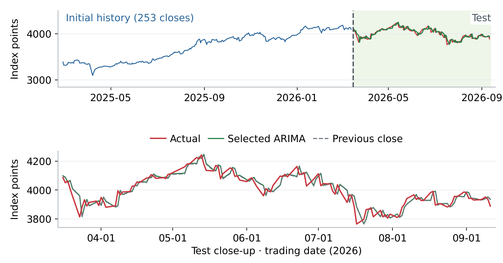
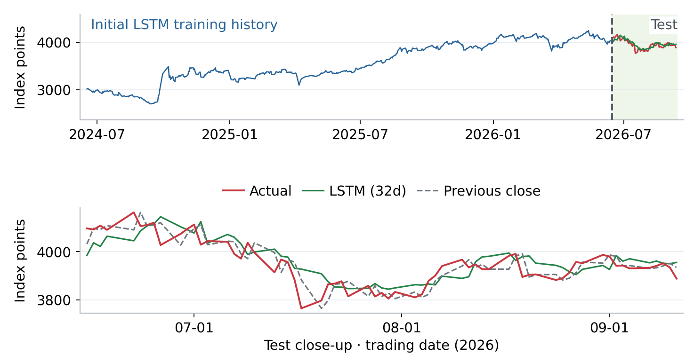

# SSE Composite Index Forecasting Experiments: Methods and Conclusions

[简体中文](README.md) | **English**

ARIMA · LSTM · PatchTST · TimesFM 2.5

This study evaluates the ability of ARIMA, LSTM, PatchTST, and TimesFM 2.5 to forecast the next-trading-day closing level of the SSE Composite Index. The core question is: under conditions that strictly limit the information available at forecast time, can a model provide a repeatable forecasting gain relative to the previous-close baseline? The repository makes public the research methods, implementation code, day-by-day forecast records, and evaluation results to support independent review. PatchTST uses the original authors' implementation, and TimesFM uses Google Research's official pretrained model; see the [third-party notices](THIRD_PARTY_NOTICES.md) for model sources and licenses.

[Read the original PDF](reports/experiment-report.pdf) · [Plotting source code](scripts/render_report_figures.py) · [How to run](#7-running-and-reproduction) · [Verify the original experiment results](results/reference/)

Report date: September 20, 2026. Experiment market data run through September 11, 2026. The research subject is the daily SSE Composite Index, and the forecast target is the next trading day's closing level. Statistical forecast accuracy and investment-strategy returns are evaluated separately; this report has not yet completed validation of strategy returns accounting for trade execution and net of costs.

**Main conclusion: within the fixed configurations and historical review periods of this study, none of the models in the main comparisons had an overall level RMSE lower than the previous-close baseline.** After improvement, ARIMA's RMSE decreased relative to the original version; the improvements of PatchTST and TimesFM 2.5 take the form of lower errors relative to the corresponding LSTM configurations. These results do not yet support the claim that the models have stable incremental predictive ability or a tradable return advantage, nor can they be extrapolated into an evaluation of all model configurations.


Figure 1  RMSE shown separately by experimental condition. Comparisons can be made within each panel; the ARIMA test period differs from that of the latter two groups, and the latter two groups also differ in input length and training method, so this does not constitute a unified architecture ranking.

| Method | Learning approach | Focus of this round |
| --- | --- | --- |
| ARIMA | Traditional statistical time-series model | Check differencing, order, and training window |
| LSTM | Recurrent neural network with gated memory | Daily-retrained comparison with two-year rolling training and 20/32-day inputs |
| PatchTST | Transformer applied after splitting the series into patches | Small model trained from scratch on local history |
| TimesFM 2.5 | Pretrained time-series Transformer | Direct forecasting with frozen official weights |

### How to read this report

First look at the data split and the forecasting task, then at the methods, actual curves, and errors of the four models, and finally at the boundaries of the conclusions. RMSE and MAE in the tables are both in index points; lower is better. Directional accuracy and investment returns are different objects of evaluation.

## 1. Data and Experimental Design

Same market-data snapshot; historical information taken strictly in time order

The data come from a saved Yahoo Finance snapshot of daily SSE Composite Index data, with ticker 000001.SS. This document organizes the existing experiments; it does not update the market data or re-select test days. The later paired experiments all use Close; the early LSTM work also explored inputs such as the opening price, high price, and volume.

| Experiment | Review period and sample | Information known at forecast time |
| --- | --- | --- |
| ARIMA improvement | 2026-03-16 to 09-11 / 125 trading days | Historical daily log returns within the window / 126 returns, 252 returns, or an expanding window |
| PatchTST and LSTM | 2026-06-15 to 09-11 / 64 trading days | Training on the preceding two years / input of the latest 20 consecutive trading days |
| TimesFM and LSTM | 2026-06-15 to 09-11 / 64 trading days | Input of the latest 32 days; LSTM trained on two years / TimesFM uses frozen pretrained weights |

### What the training history and the input window each determine

The "two-year training history" is used to form a large number of training cases; the "20-day or 32-day input" is the recent length observed by each case. For example, to forecast June 15, the LSTM uses only data from June 12 and earlier; a 32-day input covers April 27 to June 12. At the next target day, the window moves forward with the date.

### Order of rolling one-step forecasting

Step one: take the actual history before the target day. Step two: fit or load the model, and output the forecast for the next trading day. Step three: align the forecast with the actual close on the corresponding date and score it. Only after moving on to the next target day is the just-realized actual market data allowed to be added to the history. The three-month forecast lines in the figures connect 64 one-step forecasts; they are not a single forecast of the next three months.

### How the validation stage is separated from the scoring stage

ARIMA's 18 candidates were selected only on the earlier validation period of 2025-03-14 to 2026-03-13. In the later experiments, LSTM and PatchTST each day use the last 40 target days of the history window as internal validation and choose the number of epochs from at most 40 epochs; they are then re-initialized and retrained on the full known two-year history. Standardization in the validation stage does not use data from the validation target days. In this round, TimesFM is not fine-tuned, and no parameters are selected based on test error.

### Evaluation metrics and baseline

**Previous-close baseline:** predicted close = actual close of the previous trading day.
**MAE:** the average of the daily absolute errors, indicating by how many points the forecast typically deviates.
**RMSE:** the square root of the average of the squared errors; more sensitive to larger forecast deviations.

These dates had already been examined in previous research, so this document calls this a historical review. The time split prevents a day's actual value from entering that day's forecast. Repeatedly studying the same period may still introduce selection bias.

## 2. ARIMA Experiment

First check differencing, then compare a small number of parameters and training windows

**Principle and objective:** ARIMA builds a linear model from historical values and historical forecast errors; d denotes the number of differences. This project first computes the daily log return log(close of the day / previous close), and after forecasting the return, restores the index level using "previous close × exp(predicted return)". The original ARIMA(5,1,0) expanded the history, refit, and forecast the next day every day.

**Improved method:** setting d = 1 again on returns may cause extra differencing. After checking with ADF, KPSS, and autocorrelation, 6 structures × 3 windows were fixed, for 18 candidates in total; the windows are 126 returns, 252 returns, or an expanding window. Selection was made only by level RMSE on the earlier validation period; the result was ARIMA(0,0,0) with a constant and a 252-return window, which is in essence the historical average return.



Figure 2  The left side of the upper chart shows the 253 actual closes needed for the first forecast, corresponding to 252 historical returns; the right side shows the 125-day forecasts and the actual movement. The lower chart enlarges the test region. When the predicted return is close to zero, the restored level still follows changes in the previous close, so a close-fitting level curve does not mean that the next day's rise or fall was captured. See also the [daily log-return diagnostic chart](reports/figures/arima_returns.png).

| Method | RMSE | MAE |
| --- | --- | --- |
| Original ARIMA(5,1,0) | 45.20 | 35.34 |
| Selected 252-return mean | 41.68 | 31.48 |
| Previous-close baseline | 41.42 | 31.46 |

**Conclusion:** RMSE decreased by 7.79% relative to the original version but was 0.63% higher than the baseline. The block bootstrap results of the original experiment also did not confirm a stable advantage relative to the baseline. The return mean predicted a rise on all of the 125 days; the 54.4% directional accuracy equals the proportion of up days in that period and cannot be interpreted as having learned effective market timing.

## 3. LSTM Experiment

Daily retraining and one-step forecasting based on a rolling history window

**Principle:** LSTM is a class of recurrent neural networks with gated memory, which controls the updating and retention of historical information through input, forget, and output gates. This study uses its ability to model nonlinear sequential relationships to test whether recent closing sequences contain next-day predictive information beyond the previous-close baseline.

**Experimental design:** for every target day, the model is retrained on the actual closing data of the preceding two years, uses the most recent 20-day or 32-day closing sequence as input, and forecasts the next trading day's close. The 20-day version is paired with PatchTST and the 32-day version with TimesFM; each group shares the forecast dates, actual values, and previous-close baseline. Both sets of LSTM results reported in this document are rolling one-step forecasts; the early multivariate and multi-step explorations are not included in this round's performance comparison.

**Model structure:** LSTM 32 units → LSTM 16 units (ReLU) → Dense 1. Each day uses only past data; after internal validation selects the number of training epochs, the model, optimizer, and full-history standardization are re-initialized, and then all known training samples are fitted.



Figure 3  The left side of the upper chart shows the two years of actual history for the first training, and the right side shows the 64 next-day forecasts of the 32-day-input version; the lower chart enlarges the test region. Green is the LSTM, red is the actual close, and gray is the previous-day baseline. The training implementation is located separately in `experiments/lstm/`; 20-day and 32-day are merely different input parameters of the same implementation.

| Same 64 dates | RMSE | MAE |
| --- | --- | --- |
| Two-year training + 20-day input | 56.28 | 46.51 |
| Two-year training + 32-day input | 55.08 | 43.43 |
| Previous-close baseline | 42.31 | 32.26 |

**Conclusion:** in this record, the 32-day version was slightly better than the 20-day version, and neither outperformed the previous-close baseline. The 32-day version selected the 40-epoch upper limit on 19/64 target days, indicating that the conclusion is limited by the current training budget; it cannot be inferred that all LSTM configurations are ineffective.

## 4. PatchTST Experiment

A small Transformer trained on local history

**Principle:** PatchTST first cuts a time series into patches, then uses the attention mechanism to learn the relationships between patches. This project uses the authors' official supervised-learning implementation and does not load pretrained weights. The most recent 20 days are cut into 6 overlapping patches with length 5 and stride 3.

**Experimental setup:** 2 Transformer layers, 4 attention heads, d_model = 32, 17,667 parameters in total; the official RevIN and LayerNorm are used. Each day it is trained on the preceding two years of Close and compared in pairs with the LSTM using the same 20-day input. Both use the same rule for selecting the number of epochs by validation, but details such as normalization and framework still differ.


Figure 4  The left side of the upper chart is the two-year training history for the first forecast, and the right side is the 64-day test region; the lower chart enlarges the test region. The solid green line is PatchTST, the light-green dotted line is the LSTM with the same 20-day input, the red line is the actual close, and the gray line is the baseline.

| Both with 20-day input | RMSE | MAE |
| --- | --- | --- |
| PatchTST | 44.94 | 32.93 |
| LSTM | 56.28 | 46.51 |
| Previous-close baseline | 42.31 | 32.26 |

**Conclusion:** PatchTST's RMSE was 20.15% lower than that of the corresponding LSTM, but 6.20% higher than the baseline. It was better than the LSTM in all four monthly intervals, yet outperformed the baseline in none of them. The current results support "the small PatchTST is better than this version of the LSTM", but do not support "the attention mechanism has brought a tradable forecasting advantage".

## 5. TimesFM 2.5 Experiment

Frozen pretrained weights used directly for next-day forecasting

**Principle:** TimesFM 2.5 is Google's general-purpose pretrained time-series model. Unlike PatchTST, which is trained locally from scratch, it has already learned sequence patterns from external data; in this round the weights are frozen and it forecasts directly from new inputs, i.e., zero-shot inference. It was not trained specifically for the SSE Composite Index.

**Experimental setup:** the official PyTorch version is used, with the weights made public in 2025 pinned; each time, 32 actual closes are input to forecast the next trading day. The official point forecast takes the median channel. The LSTM is also retrained with a 32-day input; the dates, actual values, and baseline are exactly the same as in the 20-day group. TimesFM was not trained or fine-tuned on the two-year history on the left.


Figure 5  The blue line on the left represents only the LSTM's first training history. The green TimesFM line is formed by connecting 64 one-step forecasts; each reads only the 32 actual closes before the target day. The lower chart compares it with the 32-day LSTM and the baseline.

| Both with 32-day input | RMSE | MAE |
| --- | --- | --- |
| TimesFM 2.5 | 47.04 | 34.65 |
| LSTM | 55.08 | 43.43 |
| Previous-close baseline | 42.31 | 32.26 |

**Conclusion:** TimesFM's RMSE was 14.60% lower than that of this round's LSTM, but 11.18% higher than the baseline. Its directional accuracy of 57.81% equals that of the "always predict a rise" directional baseline (37/64), so this number alone also cannot prove market-timing value. The two differ in training information, so the difference in results cannot be attributed to architecture alone.

## 6. Overall Conclusions and Further Validation

First confirm whether a forecasting gain exists, then decide whether to add complexity

**What can be confirmed:** within the historical periods examined in this study and under the fixed configurations, the corrected ARIMA specification, the small PatchTST, and TimesFM pretrained inference can each improve some of the errors relative to their corresponding comparison models; however, the overall RMSE in each of the main comparisons is still higher than the previous-close baseline.


Figure 6  Monthly RMSE of the two 64-day experiments. June and September cover only part of the month. PatchTST did not outperform the baseline in any of the four intervals; TimesFM was slightly lower than the baseline only in June, and higher than the baseline in the remaining intervals.

### The difference between a close-fitting chart and an effective forecast

Index levels carry a strong reference to the previous day, so a model that follows the most recent level may also draw a curve that appears to fit closely. What really needs to be tested is new predictive information relative to the baseline. Curve shape, error reduction, directional hits, and profit after deducting costs are evidence at different levels. The current experiments have not validated a profitable trading strategy.

From an investment-decision perspective, the economic value of a level forecast can be tested only after it is mapped into explicit position rules and combined with a tradable instrument, signal-generation timing, execution price, transaction costs, slippage, and risk constraints. A forecast of the next trading day's close is not equivalent to an executable fill price; this study has not established the complete trading chain described above, and therefore does not interpret the forecast curves or directional accuracy directly as buy or sell instructions.

### Boundaries of applicability of the conclusions

- The sample period is short and has been examined repeatedly; there is no brand-new, completely untouched final test period.

- The 20-day and 32-day inputs differ, and the information in pretraining and in local training also differs; a fair architecture ranking across all models cannot be made.

- Local monthly wins and directional accuracy cannot prove a long-term stable advantage; the current training budget and random seeds are also limited.

### Suggested next steps

Freeze the current configurations and evaluation rules, and continue rolling tests on new dates not used for tuning; at the same time, report level errors, return errors, and the directional baseline. If a trading strategy is built later, separately validate turnover, costs, slippage, and maximum drawdown. At the current stage, priority goes to testing the information and the validation design, rather than continuing to enlarge the models.

### Result sources and reproduction records

- ARIMA: [original and improved results](results/reference/arima/).
- LSTM and PatchTST: [paired results with 20-day input](results/reference/patchtst/).
- TimesFM and LSTM: [paired results with 32-day input](results/reference/timesfm/).
- Standalone LSTM: [20-day archive](results/reference/lstm/history_20/) and [32-day archive](results/reference/lstm/history_32/), extracted column by column from the corresponding paired results, with values kept identical.
- [Release archive manifest and checksums](results/reference/manifest.json).

The charts above come from the actual forecast records of completed experiments. The current forecast charts uniformly use "actual history on the left, test comparison on the right" at the top and "test-period enlargement" at the bottom. The PDF keeps the original report, and its six original-layout figures can likewise be rebuilt with the code in the repository; `sse-*-20260914` in the PDF is the original experiment directory name. Errors can be recomputed offline from the archived data; retraining writes to `runs/`.

## 7. Running and Reproduction

### First verify the results in the report

After downloading or cloning the repository, run in the repository root:

```bash
python scripts/verify_results.py
```

This step uses only the Python standard library, and does not download market data or train networks: it recomputes the 18 MAE/RMSE metrics in the report, checks the records in the standalone LSTM against those in the paired experiments line by line, and verifies the time order, the common baseline, and the hashes of the archived files, figures, and PDF.

### Install the environment and prepare market data

This release was verified using Windows, Python 3.12, and CPU. Dependencies are pinned to locally verified versions; scripts use repository-relative paths and the current Python interpreter. Other operating systems and fresh-environment installations have not been individually tested; differences in framework versions or hardware may change the numerical results of the neural networks.

```bash
python -m venv .venv
```

Activate on Windows PowerShell: `.\.venv\Scripts\Activate.ps1`; activate on macOS/Linux: `source .venv/bin/activate`. The following commands are all executed in the activated environment, in the repository root.

```bash
python -m pip install -r requirements/base.txt
python scripts/fetch_data.py
```

This downloads the daily `000001.SS` data for the fixed range `2023-03-01` to `2026-09-11` and saves it locally to `data/yahoo_sse.json`. An existing cache is kept; add `--force` explicitly when it needs to be replaced. An existing snapshot can also be imported:

```bash
python scripts/fetch_data.py --from-file /path/to/yahoo_raw.json
```

Yahoo may rate-limit or revise historical data. The program validates the market data and records a fingerprint of the canonical dates/closing prices; newly downloaded data are not guaranteed to be exactly identical to the original experiment snapshot. See [manifest.json](results/reference/manifest.json) for the reference fingerprint. These entry points reproduce the fixed historical experiments; changing the stock or dates also requires adjusting the protocol and sample counts accordingly.

### Redraw the report figures and the original PDF figures

After installing the base dependencies and preparing historical market data consistent with the archived fingerprint, the figures can be redrawn directly; no TensorFlow, PyTorch, TimesFM weights, or retraining is needed:

```bash
python scripts/render_report_figures.py --language en
python scripts/render_report_figures.py --layout original --output runs/pdf-original-figures
```

The first command generates the six main figures of the current README and the ARIMA return diagnostic chart, written to `reports/figures/` by default. The second rebuilds the six figures of the original PDF and their original layout. Each generation checks the 34 RMSE values and whether the actual history is consistent with the archived closes, and saves a manifest of the figure sources and date ranges.

Different fonts may change the image bytes. The first command uses English labels (`--language en`), consistent with the figures in the README; without this option, Chinese figures are generated, which require fonts such as Microsoft YaHei or Noto Sans CJK SC. The figure layout is handled by the [shared plotting module](forecast_plotting.py), which the actual run outputs of the four methods also use; the left side of the TimesFM figure is explicitly a historical reference and does not represent its pretraining data.

### ARIMA

```bash
python experiments/arima/run_all.py --smoke
python experiments/arima/run_all.py --workers 3
```

The first command only verifies the original model on two days and one fit of each of the 18 candidates; the second runs, in sequence, the original ARIMA, validation-period selection, the half-year historical review, and plotting. For details, see the [ARIMA experiment entry](experiments/arima/README.md).

### Standalone LSTM: 20-day or 32-day input

```bash
python -m pip install -r requirements/lstm.txt
python experiments/lstm/run_all.py --history 20 --limit 1
python experiments/lstm/run_all.py --history 32 --limit 1
```

Removing `--limit 1` runs the full 64 days for each. There is only one copy of the training core, [experiments/lstm/train.py](experiments/lstm/train.py), and the caches are placed separately in `runs/lstm/history_20/` and `runs/lstm/history_32/`. The PatchTST/TimesFM comparisons call the same entry point and reuse the corresponding results, checking configuration, dates, data fingerprint, and input window to prevent the two kinds of cache from being mixed.

To plot only the existing archived standalone LSTM results:

```bash
python experiments/lstm/render_comparison.py --history 20 --reference
python experiments/lstm/render_comparison.py --history 32 --reference
```

The output is located in `runs/lstm_reference/history_20/` and `history_32/`, likewise using the history/test and test-enlargement layout.

### PatchTST and LSTM: 20-day input

```bash
python -m pip install -r requirements/patchtst.txt
python experiments/patchtst/run_all.py --limit 1
python experiments/patchtst/run_all.py
```

`--limit 1` verifies only the first target day, but keeps the full 40-epoch validation-based epoch selection and retraining. Remove this option to run all 64 days; runs can resume from already completed dates. The upstream source code is kept in `third_party/PatchTST/`, and each run verifies the pinned version hash. For details, see [PatchTST / LSTM20](experiments/patchtst/README.md).

### TimesFM 2.5 and LSTM: 32-day input

```bash
python -m pip install -r requirements/timesfm.txt
python experiments/timesfm/run_all.py --limit 1
python experiments/timesfm/run_all.py
```

The first run downloads about 925 MB of weights from Google's official Hugging Face repository, pins the revision, verifies the SHA-256, and caches them in `.cache/timesfm/`. Existing complete weights can be reused by specifying their directory with `SSE_TIMESFM_CHECKPOINT`. TimesFM weights are frozen; the LSTM is retrained daily. For details, see [TimesFM / LSTM32](experiments/timesfm/README.md).

### Outputs, verification scope, and directory structure

After a full run, each experiment saves daily forecasts, metrics, models, and charts under `runs/`. Running only `--limit 1` does not generate the full 64-day metrics. All LSTM training is invoked uniformly from `experiments/lstm/`; the old `run_lstm.py` in the paired directories is kept only as a compatibility entry point.

This repository consolidation has completed:

- Offline verification of archived results, data-integrity and plotting time-boundary tests, and Python compilation checks.
- Limited fitting verification of the original ARIMA model on two days and of the 18 candidates.
- Full first-day training of PatchTST, LSTM20, and LSTM32, as well as actual first-day TimesFM inference and model-reload verification; the first-day forecasts of the four branches are consistent with the original experiment records.
- The full 64-day network training was not re-executed at release; the full-period metrics in this document come from the archived original experiments.

```bash
python -m unittest discover -s tests -v
python -m unittest experiments.lstm.test_protocol -v
```

```text
sse-forecast-benchmark/
├── README.md                  # Illustrated experiment report and run guide (Chinese)
├── README.en.md               # English version of the README
├── benchmark_support.py       # Market-data validation and data fingerprint
├── forecast_plotting.py       # History/test layout shared by the four methods
├── experiments/
│   ├── arima/                 # Original model, parameter/window comparison, and plotting
│   ├── patchtst/              # PatchTST, calls the shared LSTM20 comparison
│   ├── timesfm/               # TimesFM 2.5, calls the shared LSTM32 comparison
│   └── lstm/                  # Standalone LSTM; one training implementation supports 20/32 days
├── requirements/              # Pinned dependencies split by experiment
├── scripts/                   # Market-data download, result verification, PDF/report figure rebuilding
├── tests/                     # Data-integrity and plotting time-boundary tests
├── results/reference/         # Published experiment records and checksum manifest
├── reports/                   # Original PDF, six main figures, and return diagnostics
├── third_party/PatchTST/      # Subset of the original authors' source code and license
├── data/                      # Local market-data cache; raw data are not committed
└── runs/                      # Output of new local runs; models are not committed
```

## 8. Sources and Licensing

The work of this study includes data processing, the rolling forecast protocol, model implementation and invocation, baseline evaluation, and visualization. ARIMA is implemented using statsmodels, and the LSTM is built on TensorFlow/Keras; the PatchTST architecture and official implementation, and the TimesFM architecture and pretrained weights, belong to their original authors. For sources, versions, citations, and usage, see [THIRD_PARTY_NOTICES.md](THIRD_PARTY_NOTICES.md).

The licensable new code of this project is released under the [Apache License 2.0](LICENSE). Third-party code retains its original licenses and attribution; model licenses do not grant rights to third-party market data.

## 9. Methodological Purpose and Investment Risk Warning

This study aims to characterize and forecast price changes in real markets as accurately as possible, and strives to improve the reliability and verifiability of its results through data validation, strict time splits, rolling forecasts, and baseline comparisons. The current empirical subject is the SSE Composite Index; the conclusions cannot be directly extrapolated to individual stocks, other markets, or future periods. The research objectives and technical investment do not constitute a guarantee of forecast accuracy, future returns, or the safety of principal.

**This repository and its report, code, charts, and model outputs are for methodological research and technical reference only. They do not constitute investment advice, recommendations to buy or sell securities, personalized asset-allocation plans, or promises of returns, and should not be used as the sole basis for actual investment decisions.**

Historical review results do not represent future performance. This study has not yet proven that the models have a stable forecasting advantage over a simple baseline, nor has it completed investment-strategy validation that includes transaction costs, slippage, liquidity, and execution constraints. Data errors, model failure, changes in market conditions, and unexpected events may all cause forecasts to deviate significantly from actual movements. Investment carries the risk of loss of principal; any actual use must incorporate independent judgment, one's own risk tolerance, and sufficient follow-up validation, and investors bear the decision risks themselves.
